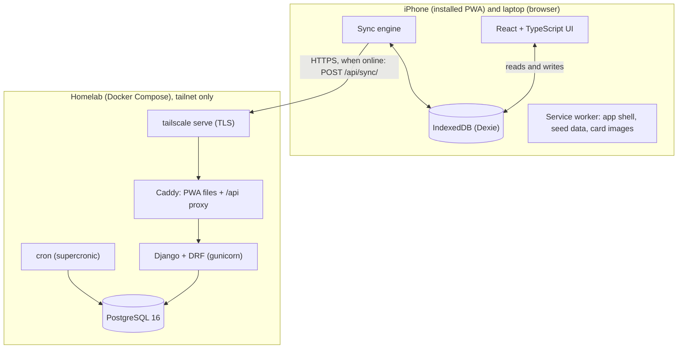

# Arcana

> Working name. An offline-first practice app for a tarot reader: clients, sessions, spreads,
> payments, card and crystal reference, and natal charts, synced between an iPhone and a laptop
> through a small self-hosted server.

[](https://github.com/mariano-fu/arcana/actions/workflows/ci.yml)

<!-- TODO(T5.3): test coverage badge, once CI measures coverage. No placeholder numbers. -->

**Status:** work in progress; see [`specs/tasks.md`](specs/tasks.md).

## The problem

A tarot reader starting a small business needs one place for her clients and their readings,
with reference material (cards, astrology, crystals) at hand during a session. Today that lives
in her head, a notes app and message threads. She works from an iPhone, often with a weak
signal or none, and can't wait for a spinner while a client is in front of her. The data is
personal and sensitive, so it should stay on her devices and a server she controls. Clients
never use the app.

## Screenshots

<!-- TODO(T5.3): iPhone GIF and 2–3 screenshots, taken in demo mode (T5.4) with fake clients.
     Never real client data. -->

_Screenshots and a short iPhone recording will go here._

## What it does

- **Clients:** profile, birth data, notes and tags, search as you type, archive.
- **Sessions:** autosaved notes, follow-ups, one or more tarot spreads per session, with the
  exact cards and positions kept for every past reading.
- **Payments:** records what she received (no payment processing), with pending balances per
  currency.
- **Reference:** the 78 Rider-Waite-Smith cards (public-domain scans) with her own notes,
  spreads (including her own), zodiac profiles, and explainable crystal recommendations for a
  client's signs and chosen intentions, from a seed library of about 50 crystals.
- **Astrology:** sun sign, natal summary and, when the birth time is known, rising sign and
  houses, computed on the device.
- **Sync and backup:** two devices kept in step when they have network; one-tap JSON export and
  import that works without the server.
- Daily horoscopes are planned (Phase 4).

The UI is in Spanish (via i18next); code, docs and tests are in English.

## Architecture



The key decision: **the UI never calls the API for data.** Every screen reads and writes the
local IndexedDB database; a separate sync engine reconciles it with the server in the background.
Offline is therefore the normal mode, not a fallback, and a slow or missing network never blocks
a reading. The reasoning is in [ADR 0001](docs/decisions/0001-offline-first.md); the full design
is in [`specs/plan.md`](specs/plan.md#architecture-at-a-glance).

| Part      | Stack                                                                                                                                                                  |
| --------- | ---------------------------------------------------------------------------------------------------------------------------------------------------------------------- |
| `web/`    | Vite, React, TypeScript (strict), Dexie + `useLiveQuery`, Zod, Tailwind CSS, i18next, Luxon, `astronomy-engine` plus a small house/ascendant module, `vite-plugin-pwa` |
| `api/`    | Python 3.13, Django + Django REST Framework, PostgreSQL 16, simplejwt, drf-spectacular, managed with uv                                                                |
| `deploy/` | Docker Compose: Caddy, gunicorn, Postgres, a one-shot migrate and a cron container, reachable only over Tailscale                                                      |

The server is a single tenant (one practice's data) and is reachable only inside a tailnet:
`tailscale serve` terminates HTTPS on the host and proxies to Caddy, which serves the PWA and
`/api` from the same origin (no CORS). Nothing is exposed to the public internet. See
[`deploy/README.md`](deploy/README.md).

## Offline-first sync: design and trade-offs

Details and the exact rules live in [`specs/plan.md`, "Sync protocol"](specs/plan.md#sync-protocol);
this is the short version.

- **One idempotent endpoint, push then pull.** Every local write marks its row `pending`. A sync
  run pushes pending rows in chunks, then pulls everything with a `server_version` above the
  device's cursor. Retrying the same push is a no-op, so a run interrupted at any point can
  simply run again. Sync runs on app open, on returning to the foreground, on regaining
  connectivity, shortly after an edit and from a manual button.
- **Client-generated ids.** UUIDv7 for normal rows, so devices create records offline without
  collisions; deterministic UUIDv5 where two devices must land on the same row (seed data, a
  card position in a reading, a note per card).
- **Last-write-wins per record, by `updated_at`.** Simple and predictable for one person on two
  devices. _Trade-off:_ it trusts client clocks and works per record, not per field.
- **Free text is never silently lost.** When a note loses last-write-wins, the losing text is
  stored as a conflict row, and the app asks her to keep, swap or combine the versions.
  _Trade-off:_ occasional manual review instead of an automatic merge (no CRDTs).
- **Clock handling.** Local writes get a strictly increasing `updated_at` per row, even if the
  clock repeats or goes backwards. Each response carries the server time; the measured skew is
  stored and Settings warns when it is over two minutes.
- **Tombstones, never hard deletes.** Deletes set `deleted_at` and sync like any edit. Both the
  client database layer and the Django models refuse hard deletes on synced tables, because a
  removed row would never reach the other device.
- **Epochs.** Each server database has a random epoch id. If a device sees a different one (the
  server was restored or rebuilt), it resets its cursor and re-pushes all its rows with their
  original edit times, so last-write-wins still compares real edits.
- **Seed data vs. her edits.** Cards, spreads, crystals and zodiac profiles ship as versioned
  JSON. Seed rows are created on each device from its own bundle and never sync until she edits
  them, and seed updates never overwrite her edits
  ([details](specs/plan.md#seed-vs-user-edits-principle-5)).

**Known limits, stated honestly:**

- Data at rest in IndexedDB is not encrypted.
- iOS may evict web storage. Installed home-screen apps are much less exposed than Safari tabs,
  but backups stay mandatory: the app requests persistent storage and offers JSON export
  ([export/import](specs/plan.md#export--import-t113)).
- Tailscale only. iOS allows one VPN at a time, so sync waits while another VPN is on; the app
  itself keeps working.
- Single tenant and single reader by design; multi-user is out of scope.

## Privacy and security

- No analytics, trackers, CDNs or external fonts at runtime.
- The server is reachable only inside the tailnet, over HTTPS, and every endpoint except
  `GET /api/health/` still requires a JWT (short-lived access token, rotating refresh token,
  rate-limited login).
- Secrets come only from `.env` files, which are gitignored. Containers run as non-root with
  read-only root filesystems.
- Tests, fixtures and seed files never contain real client data.

More in [`specs/plan.md`, "Security"](specs/plan.md#security).

## Running locally

Requirements: Node 26 (`.nvmrc`), Python 3.13 with [uv](https://docs.astral.sh/uv/), and Docker
for Postgres.

**Web** (the dev server proxies `/api` to `http://localhost:8000`):

```sh
cd web
npm ci
npm run dev
```

The app works fully without the API; only sync needs it.

**API:**

```sh
cd api
uv sync
cp .env.example .env
docker run -d --rm --name arcana-pg -p 5432:5432 \
  -e POSTGRES_USER=arcana -e POSTGRES_PASSWORD=arcana -e POSTGRES_DB=arcana \
  postgres:16-alpine
uv run python manage.py migrate
uv run python manage.py createsuperuser   # the account the app signs in with
uv run python manage.py runserver
```

More in [`api/README.md`](api/README.md). The deployed stack is described in
[`deploy/README.md`](deploy/README.md).

## Tests and CI

```sh
cd web && npm test && npm run lint && npm run typecheck
cd api && uv run pytest && uv run mypy . && uv run ruff check .
```

The API tests need the Postgres container above (there is no SQLite fallback). The Playwright
end-to-end tests run only in CI.

[CI](.github/workflows/ci.yml) runs on every pull request and on pushes to `main`:

| Job      | What it checks                                                                                                                                                                   | Required on `main` |
| -------- | -------------------------------------------------------------------------------------------------------------------------------------------------------------------------------- | ------------------ |
| `web`    | ESLint, type check, Vitest, the generated API types match `api/openapi.yaml`, production build                                                                                   | yes                |
| `api`    | Ruff (lint and format), mypy, no missing migrations, the committed OpenAPI schema is current, pytest against Postgres 16, Docker image build                                     | yes                |
| `e2e`    | Playwright on WebKit with an iPhone profile against the production build and its service worker, including offline reloads; every test fails if the app makes any `/api` request | no                 |
| `deploy` | [`deploy/smoke.sh`](deploy/smoke.sh): builds and starts the whole Compose stack and checks it from the host                                                                      | no                 |

Beyond the usual unit and component tests, there are dedicated tests for the sync conflict
rules (both on the client, against a fake sync server, and on the server), the astrology math,
and the seed content itself: crystal texts are checked for health or medical claims and card
meanings for gender-neutral wording.

## Repo layout

| Path      | What                                                                                                                          |
| --------- | ----------------------------------------------------------------------------------------------------------------------------- |
| `web/`    | PWA: Vite + React + TypeScript, Dexie (IndexedDB), sync engine, astrology module                                              |
| `api/`    | Sync server: Django + DRF + PostgreSQL                                                                                        |
| `deploy/` | Docker Compose (Caddy, api, db, migrate, cron) for the homelab                                                                |
| `docs/`   | Architecture decision records, spikes and generated content review files                                                      |
| `specs/`  | Source of truth: [constitution](specs/constitution.md), [spec](specs/spec.md), [plan](specs/plan.md), [tasks](specs/tasks.md) |

## License

[MIT](LICENSE)
